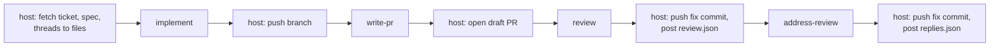

# sd-runner

What an unattended run executes: the scripts that drive Claude Code through [sandcastle](https://github.com/mattpocock/sandcastle), their prompts, the policy Claude Code reads above every other settings level, the shell script that prepares a host, and the skills a run loads when the code repo has none of its own.

A host workflow checks this repo out at a full commit SHA and calls into it. Nothing here knows which tracker, repository or organisation the host serves.

## Quick start

On an Ubuntu host with `sudo` and `jq`:

```sh
# 1. This repo checked out at a full commit SHA, never a branch or tag
(cd <runner> && npm ci)

# 2. Claude Code at the pinned version, the runner policy, the checkout's project settings neutralised
<runner>/bin/prepare-host.sh <checkout>

# 3. Inputs: files the host fetched, named by environment variables
export BRANCH=feature/x BASE_BRANCH=main EXTERNAL_REF=<ref> OUTPUT_DIR=/tmp/out
export TICKET_FILE=ticket.md SPEC_FILE=spec.md SIBLINGS_FILE=siblings.md

# 4. Run a script from the checkout's root, with this repo's own tsx
cd <checkout> && node <runner>/node_modules/.bin/tsx <runner>/implement/implement.ts
```

Then read `OUTPUT_DIR` and act on it: push, open the pull request, post. The full steps, skill copies included, are in [docs/wiring.md](docs/wiring.md).

## How a run flows



The scripts never call a tracker or code-host API and never hold a GitHub token. The host fetches before, and pushes and posts after.

## Scripts

| Script                                                | What it does                                                                               | Reads                                                                      | Writes to `OUTPUT_DIR`               |
| ----------------------------------------------------- | ------------------------------------------------------------------------------------------ | -------------------------------------------------------------------------- | ------------------------------------ |
| [`implement`](docs/implement.md)                      | Works the ticket on `BRANCH` through the `implement` and `tdd` skills; one or more commits | `TICKET_FILE`, `SPEC_FILE`, `SIBLINGS_FILE`, `DIAGNOSTICS_FILE` (optional) | nothing on success                   |
| [`write-pr`](docs/write-pr.md)                        | Drafts the pull request title and description from the diff                                | `TICKET_FILE`                                                              | `pr_title.txt`, `pr_description.txt` |
| [`review`](docs/review.md)                            | Runs the `code-review` skill against `BASE_BRANCH`; at most one fix commit; opens threads  | `TICKET_FILE`, `SPEC_FILE`, `THREADS_FILE`                                 | `review.json`                        |
| [`review`, confirm mode](docs/review.md#confirm-mode) | Optional, unused by current hosts: judges fixes on HEAD, read-only                         | the same, `REVIEW_MODE=confirm`                                            | `review.json`, `verdicts.json`       |
| [`address-review`](docs/address-review.md)            | Fixes or declines each thread that is the fixer's work; at most one commit                 | `TICKET_FILE`, `SPEC_FILE`, `THREADS_FILE`                                 | `replies.json`, `summary.md`         |

Every script also reads `BRANCH`, `BASE_BRANCH`, `EXTERNAL_REF`, `OUTPUT_DIR` and `MODEL`, and runs from the checkout's root.

## Inputs

| Variable                                    | Meaning                                                                                                                                                                                                                                    |
| ------------------------------------------- | ------------------------------------------------------------------------------------------------------------------------------------------------------------------------------------------------------------------------------------------ |
| `BRANCH`                                    | branch to work on, already checked out                                                                                                                                                                                                     |
| `BASE_BRANCH`                               | branch it was cut from and merges into; for `review` and `write-pr`, any ref that resolves in the checkout (`origin/main`, say), since `review` diffs `BASE_BRANCH...HEAD` and `write-pr`'s agent runs `git log` and `git diff` against it |
| `EXTERNAL_REF`                              | opaque reference to the work in the host's system                                                                                                                                                                                          |
| `TICKET_FILE`, `SPEC_FILE`, `SIBLINGS_FILE` | files the host fetched before the run; each reaches the prompt as a tagged data block (`<ticket>`, `<spec>`, `<siblings>`)                                                                                                                 |
| `DIAGNOSTICS_FILE`                          | `implement` only, optional: commands the agent runs and reports before the task, for proving a runner control on one run ([details](docs/implement.md#diagnostics))                                                                        |
| `THREADS_FILE`                              | `review` and `address-review`: the pull request's existing discussion as JSON ([shape](docs/threads.md#threads_file)), reaching the prompt as `<threads>`                                                                                  |
| `REVIEW_MODE`                               | `review` only: `review` (default) or the optional `confirm`                                                                                                                                                                                |
| `OUTPUT_DIR`                                | where results go (default: the OS temp dir)                                                                                                                                                                                                |
| `MODEL`                                     | Claude model id (default in `prompt-args.ts`)                                                                                                                                                                                              |

- The Claude credential is not read by the scripts: Claude Code inherits it from the step's environment. It is the only credential a run holds.
- The `implement` and `address-review` prompts read the code repo's `GLOSSARY.md` and `docs/adr/` where they exist.

## Outputs and failures

- A failed script writes `failure_reason.txt` to `OUTPUT_DIR` and exits 1. A missing required variable exits 1 without it.
- Outputs are neutral text and JSON a host maps onto its own system, with one exception: `review.json` is already the body of GitHub's create-review API call, and stays GitHub-shaped until a second code host is real.
- `replies.json` and `verdicts.json` are host-neutral: each entry is the id the host gave a comment in the threads file, plus a body (and, in `verdicts.json`, `verified`). The host maps it onto its own reply endpoint.

## Layout

- `implement/`, `write-pr/`, `review/`, `address-review/`: one script each, with its prompt. `review.ts` and `address-review.ts` only read the environment and record failures, so the flows in `run-review.ts` and `run-address-review.ts` can be tested against a throwaway repo with sandcastle mocked. `review/threads.ts` holds the [thread openers](docs/threads.md) every stage reads.
- `run-with-retry.ts`, `run-with-extraction.ts`, `retry-feedback.ts`: wrappers over sandcastle's `run()` that resume the agent's session with feedback when structured output fails validation.
- `no-sandbox.ts`: sandcastle's host provider with the agent's stderr forwarded to the log as it arrives. Sandcastle's own keeps stderr for the error it raises on a non-zero exit, so a warning on a successful run would be lost.
- `failure-reason.ts`: the reason a run records when it fails on a thrown error, trimmed to sandcastle's header and the `error:` line when the CLI crashed, since the full dump is already in the log.
- `policy/`: `managed-settings.json` (hooks off, web and MCP tools denied, pinned env, sandbox with a strict one-host allowlist, `~/.npm` writable so `npm ci` works, the Claude credential `CLAUDE_CODE_OAUTH_TOKEN` denied to sandboxed commands) and `managed-mcp.json` (no servers).
- `bin/`: `prepare-host.sh`, which a host calls, and the two scripts it runs, `install-runner-policy.sh` and `neutralise-checkout-settings.sh`; `test.sh`.
- `skills/`: `code-review/`, `implement/` and `tdd/`, copies of the upstream skills the `review` and `implement` scripts run, for a code repo that has no copy of its own. `skills/README.md` records the upstream commit; `skills/LICENSE` is its MIT licence.

## Public repo

This repo is public, so a host needs no read credential and the team whose code a run touches can audit exactly what runs.

Nothing committed here (code, prompts, docs, tests, fixtures, commit messages, changesets) names a client, a client's repository or a client's tracker. Examples use placeholders (`src/a.ts`, `dev`, `<sha>`); host-specific values arrive at run time through the inputs.

## Tests

```sh
npm run check
```

Runs the typecheck, the vitest suite and `bin/test.sh`. CI runs it on every pull request and on `main`.

- **vitest:** the retry and extraction wrappers, the review and address-review flows with sandcastle's `run` mocked against throwaway repos, every output schema, the thread kinds, comment, reply and verdict validation, the diff anchor index, data blocks, prompt placeholders, the diagnostics section, the failure reason and the stderr-forwarding provider.
- **`bin/test.sh`:** the shell scripts against throwaway git repos, with the policy and Claude Code's link in temp dirs and `sudo` stubbed.

## Changes

- Every change that alters what a run does carries a changeset (`npm run changeset`), updating a copied skill included.
- History before the move to this repo, blame included, comes from the skills fork's `runner/` directory; `Merge pull request SiliconDali/skills#N` commits refer to that repo's pull requests.
- The wrappers and their tests are adapted from [mattpocock/course-video-manager](https://github.com/mattpocock/course-video-manager) (MIT).
